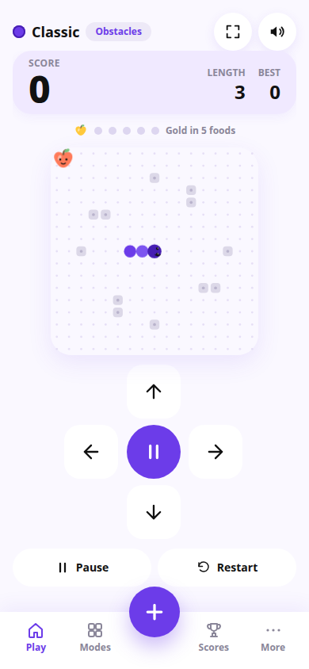

# Snake — Four ways to play

Snake is a phone-first Snake game prototype with four modes: Classic, Wrap, Timed, and Zen, plus an obstacles option for Classic.

## What it does

- Normal food grows the snake, and a golden food worth bonus points appears on a timer after every five foods.
- Swipe, on-screen D-pad, and keyboard controls.
- Three board sizes and six snake skins.
- Separate best scores per mode, and a history and stats view that starts at zero and only records real games.

## Status

Working prototype, built November 2026. A signed Android APK of this game also exists.

## Showcase only

This repository is a showcase. It contains no source code and no build files, and nothing here is open source. The screenshot(s) above are showcase images only. See NOTICE.md.

## Contact

Built by Yash Dashrath, Pune, India.

- Email: yashdashrath18@gmail.com
- LinkedIn: https://www.linkedin.com/in/yash-dashrath
- Yash MediaWorks: https://www.linkedin.com/company/yashmediaworks/
